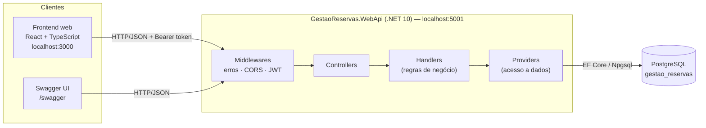
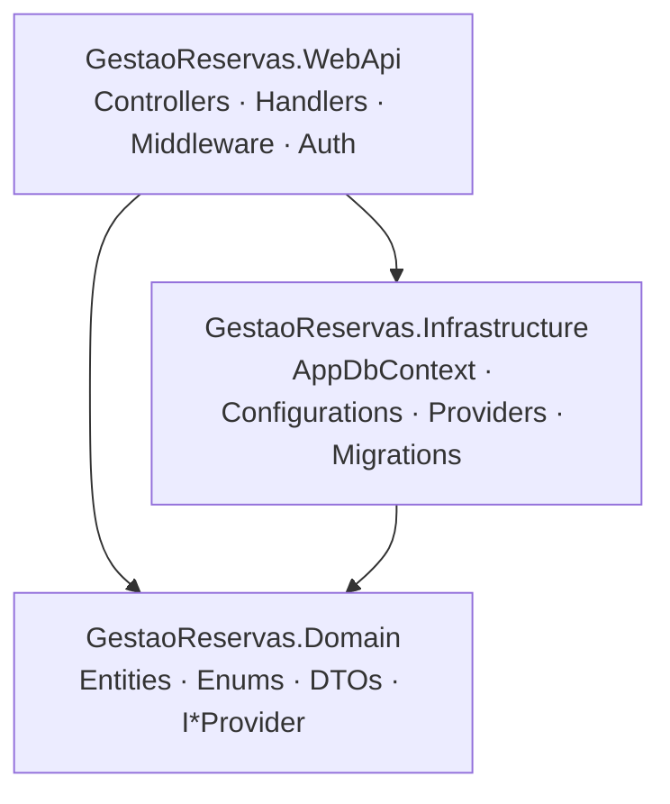
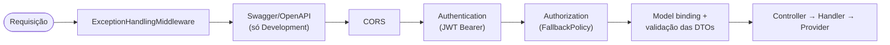
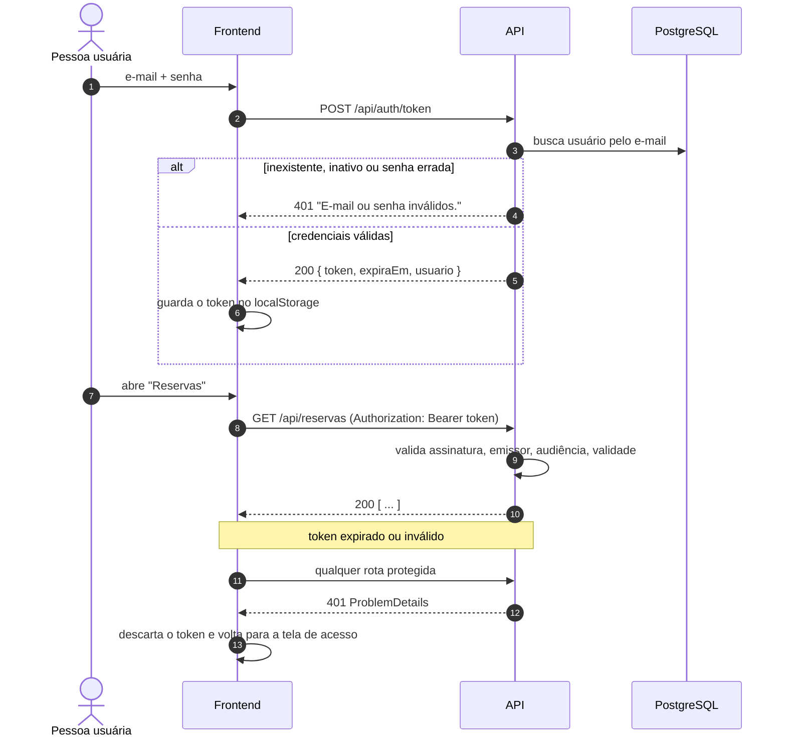

# Arquitetura do sistema

Este documento descreve como o sistema de gestão de reservas está organizado: as camadas do backend, o caminho de uma requisição, a autenticação, a organização do frontend e as principais decisões técnicas. Regras de negócio e instruções de execução estão no [README](../README.md); a estrutura do banco está no [dicionário de dados](dicionario-dados.md).

## 1. Visão geral



- Todos os clientes falam com a API por HTTP e JSON; nenhum acessa o banco diretamente.
- A API é a única dona das regras de negócio. O frontend repete algumas validações só para dar retorno imediato à pessoa usuária, mas sempre aceita a resposta da API como definitiva.
- O banco é criado e atualizado pelas *migrations* do EF Core, aplicadas automaticamente quando a API inicia.

## 2. Camadas do backend

A solução (`GestaoReservas.slnx`) separa o backend em três projetos. As referências apontam sempre "para dentro", em direção ao domínio:



| Camada | Contém | Não contém |
|---|---|---|
| **Domain** | Entidades (`Usuario`, `Local`, `Reserva`...), `EntidadeBase` com o `Ativo`/`Desativar()`, enum `TipoCategoria`, DTOs de entrada/saída com *data annotations* e as interfaces `I*Provider`. | Nenhuma dependência de EF Core, ASP.NET ou banco. |
| **Infrastructure** | `AppDbContext`, mapeamento Fluent API por entidade (`Data/Configurations`), implementações dos providers (consultas EF Core) e migrations. | Regras de negócio — os providers só consultam e gravam. |
| **WebApi** | Controllers finos, *handlers* com as regras de negócio, autenticação JWT, middleware de erros e composição de dependências em `Program.cs`. | SQL ou acesso direto ao `DbContext`. |

Responsabilidade de cada peça numa operação:

| Peça | Exemplo (`POST /api/reservas`) |
|---|---|
| **Controller** | `ReservasController.Criar` recebe o `CriarReservaDto`, chama o handler e devolve `201 Created` com `Location`. |
| **Handler** | `ReservaHandler.CriarAsync` valida usuário, período, escopo, local, recursos, janela de dias e conflito de horário; monta a entidade; lança exceções de domínio quando algo é violado. |
| **Provider** | `LocalProvider`/`RecursoProvider` buscam o local e os recursos; `ReservaProvider.ListarAtivasNoPeriodoAsync` traz as reservas ativas nas mesmas datas (o handler calcula a sobreposição exata de data+hora) e `AdicionarReservaAsync`/`SalvarAlteracoesAsync` gravam. |
| **DTO** | Fronteira da API: a entidade nunca é serializada diretamente (a `Senha`, por exemplo, nunca sai). |

As DTOs ficam no Domain porque descrevem o contrato da API independentemente de como ela é exposta; a WebApi apenas as recebe e devolve.

## 3. Caminho de uma requisição

Ordem do *pipeline* configurado em `Program.cs`:



1. **`ExceptionHandlingMiddleware`** envolve todo o resto e converte exceções em `application/problem+json`:

   | Exceção | HTTP |
   |---|---|
   | `RegraDeNegocioException` | 400 |
   | `NaoAutenticadoException` | 401 |
   | `EntidadeNaoEncontradaException` | 404 |
   | `ConflitoException` | 409 |
   | `DbUpdateException` por índice único ou FK (PostgreSQL) | 409 |
   | qualquer outra | 500 (detalhe só no log) |

2. **CORS** libera as origens de `Cors:Origens` (o frontend em `localhost:3000`).
3. **Authentication** lê o cabeçalho `Authorization: Bearer ...` e valida assinatura, emissor, audiência e validade do token.
4. **Authorization**: uma `FallbackPolicy` exige usuário autenticado em toda rota que não tenha `[AllowAnonymous]`. Assim, um controller novo já nasce protegido — não é preciso lembrar de colocar `[Authorize]`. Quando falta token, o evento `OnChallenge` responde 401 no mesmo formato `ProblemDetails` do restante da API.
5. **Validação automática** (`[ApiController]`) devolve 400 com o dicionário `errors` quando as *data annotations* da DTO falham, antes de chegar ao handler.

## 4. Autenticação



Peças envolvidas:

| Peça | Papel |
|---|---|
| `AuthController` | `POST /api/auth/token` (público) e `GET /api/auth/me`. |
| `AuthHandler` | Compara a senha, emite o token com `JsonWebTokenHandler` (HMAC-SHA256) e as *claims* `sub`, `email`, `name`. |
| `JwtOptions` | Seção `Jwt` do `appsettings`: `Chave`, `Emissor`, `Audiencia`, `ExpiracaoMinutos`. |
| `UsuarioLogadoExtensions` | `User.ObterUsuarioId()` lê o id do usuário da claim `sub`. |
| `UsuariosController.Criar` | Marcado com `[AllowAnonymous]` para permitir criar a primeira conta. |

O token é *stateless*: a API não guarda sessões. Por isso não há "logout no servidor" — sair significa o cliente descartar o token. Um usuário desativado continua com o token válido até ele expirar; o `GET /api/auth/me` (usado pelo frontend ao reabrir a página) já recusa usuários inativos.

## 5. Frontend

### 5.1 Pilha

| Item | Escolha |
|---|---|
| Linguagem | TypeScript (modo `strict`) |
| UI | React 19 |
| Build/dev server | Vite 7, porta fixa 3000 |
| HTTP | axios, com interceptadores para o token |
| Estilo | CSS puro com variáveis (`src/index.css`), sem framework |
| Navegação | Roteamento por *hash* próprio (`#/reservas`), sem biblioteca |
| Testes | Vitest + Testing Library, em navegador simulado (jsdom) |

### 5.2 Organização das pastas

```
src/GestaoReservas.Web/src
├── main.tsx                 # monta <NotificacoesProvider><AuthProvider><App/>
├── App.tsx                  # decide: verificando sessão → Login → Layout + página da rota
├── index.css                # tokens de cor (tema escuro), componentes e responsivo
├── types/index.ts           # espelho das DTOs da API
├── services/
│   ├── axios.ts             # instância axios, armazenamento do token, interceptadores
│   └── api.ts               # usuariosApi, locaisApi, ... (gerados por cadastro()), authApi, mensagemDeErro
├── contexts/
│   ├── auth.ts / AuthProvider.tsx                 # usuário logado, entrar, sair
│   └── notificacoes.ts / NotificacoesProvider.tsx # avisos temporários (toasts)
├── hooks/
│   ├── useRota.ts           # rota atual a partir do hash
│   ├── useCarregar.ts       # busca dados com estado de carga/erro e recarregar()
│   └── useFormulario.ts     # estado do modal de cadastro/edição e da confirmação
├── components/              # Layout, Modal/Confirmar, Tabela, Campo, Pagina (cabeçalho, filtros, selos), Icone
├── pages/                   # Login, Inicio, Reservas, Locais, Recursos, Categorias, Usuarios
├── utils/formatos.ts        # datas, duração em dias, situação da reserva, busca sem acento
└── test/setup.ts            # configuração comum dos testes
```

Os testes ficam ao lado do arquivo testado, com o sufixo `.test.ts(x)` (ex.: `utils/formatos.test.ts`).

### 5.3 Comunicação com a API

- `services/api.ts` tem uma função `cadastro<T, TCriar, TAtualizar>(caminho)` que gera os cinco métodos padrão (`listar`, `obter`, `criar`, `atualizar`, `desativar`). Os cinco cadastros reaproveitam essa função, porque todas as rotas seguem o mesmo contrato.
- O interceptador de requisição adiciona `Authorization: Bearer {token}` quando há token salvo.
- O interceptador de resposta, ao receber 401 de uma rota que não seja o login, remove o token e dispara o evento `gestao-reservas:sessao-expirada`. O `AuthProvider` escuta esse evento, avisa a pessoa e volta para a tela de acesso.
- `mensagemDeErro()` transforma o `ProblemDetails` da API (campo `title` ou o dicionário `errors` da validação automática) numa mensagem legível. Sem resposta do servidor, informa que a API está fora do ar.

### 5.4 Estado e telas

- **Sessão**: `AuthProvider` guarda o usuário logado. Ao abrir a página com um token salvo, chama `GET /api/auth/me` para confirmar que ele ainda vale antes de mostrar o sistema.
- **Dados das telas**: cada página busca o que precisa com `useCarregar` e chama `recarregar()` depois de criar, editar ou desativar. Não há cache global — o volume de dados é pequeno e assim a tela sempre mostra o estado atual do banco.
- **Formulários**: `useFormulario` concentra o padrão "modal de cadastro/edição": valores, id em edição, envio e erro da API. O erro aparece dentro do modal, que continua aberto para correção; ao editar qualquer campo o erro some.
- **Reservas**: além de enviar à API, a tela calcula localmente a duração em dias (mesma regra de arredondamento do `ReservaHandler`), sinaliza recursos fora da janela de dias e marca local/recursos já ocupados no período, comparando com as reservas ativas já carregadas. São avisos — a checagem que vale é a da API (409).

### 5.5 Estilo e responsividade

- A interface usa somente o tema escuro. Cores, raios e sombras são variáveis CSS em `:root`; os componentes usam só essas variáveis, então mudar a paleta é mexer em um lugar.
- Acima de 1080px: menu lateral fixo. Abaixo: barra no topo e menu em gaveta.
- Abaixo de 720px: as tabelas viram cartões (cada célula mostra o título da coluna via `data-titulo`), os formulários passam a uma coluna e os botões do modal ocupam a largura toda.
- Modais usam o `<dialog>` nativo, que já prende o foco e fecha com Esc.

## 6. Decisões técnicas

| Decisão | Alternativas consideradas | Motivo |
|---|---|---|
| Handlers separados dos controllers | Regras no controller ou em *services* genéricos | Controllers ficam só com HTTP; as regras ficam testáveis e num lugar só. |
| Providers com interface no Domain | Usar o `DbContext` direto nos handlers | Isola o EF Core da regra de negócio e deixa claro o que cada handler consulta. |
| Exclusão lógica (`Ativo`) | `DELETE` físico | Requisito do trabalho; preserva o histórico de reservas canceladas. |
| Exceções de domínio + middleware | `return BadRequest(...)` espalhado pelos handlers | Um único ponto define o formato de erro (`ProblemDetails`) e o código HTTP. |
| JWT com chave simétrica | Cookie de sessão; ASP.NET Identity | Funciona para qualquer cliente HTTP (frontend, Swagger, Postman), sem estado no servidor e sem as tabelas extras do Identity. |
| `FallbackPolicy` global | `[Authorize]` em cada controller | Protegido por padrão; só o que é público precisa ser marcado. |
| Cadastro de usuário público | Exigir token também no cadastro | Sem isso não haveria como criar o primeiro usuário. |
| Roteamento por hash próprio | React Router | São seis telas fixas sem parâmetros; evita uma dependência. |
| CSS puro com variáveis | Tailwind, biblioteca de componentes | Nenhuma dependência nova e controle total do visual, com a paleta centralizada nas variáveis. |
| Somente tema escuro | Alternar entre claro e escuro | Uma única paleta para manter e testar; menos código no frontend. |
| Vitest para os testes do frontend | Jest | Usa a mesma configuração do Vite (TypeScript e JSX sem configuração extra). Versão 4, que funciona com Node 20. |
| Validações repetidas no frontend como aviso | Só a API valida | Retorno imediato (duração, conflito) sem perder a API como fonte da verdade. |

## 7. Limitações conhecidas e próximos passos

| Limitação | Impacto | Próximo passo sugerido |
|---|---|---|
| Senha em texto puro | Vazamento do banco expõe as senhas. | Gravar hash (ex.: `PasswordHasher<T>` do ASP.NET ou BCrypt) e migrar as senhas existentes. |
| Sem perfis/papéis | Qualquer usuário logado mantém todos os cadastros e pode reservar em nome de outro via API. | Criar papel de administrador; restringir cadastros e forçar `UsuarioId` = usuário do token na reserva. |
| Token não é revogado | Usuário desativado mantém acesso até o token expirar (8h). | Validar `Ativo` a cada requisição (evento `OnTokenValidated`) ou reduzir a validade com *refresh token*. |
| Chave JWT de desenvolvimento no repositório | Insegura fora do ambiente local. | Definir `Jwt:Chave` por User Secrets/variável de ambiente em qualquer outro ambiente (o README explica). |
| Conflito de horário checado antes do `INSERT` | Duas requisições simultâneas podem passar pela checagem ao mesmo tempo. | Restrição de exclusão no PostgreSQL (`EXCLUDE USING gist` com `tsrange`) ou transação serializável. |
| Listas sem paginação | Lento com muitos registros. | Paginação e filtros no servidor (`?pagina=&tamanho=`). |
| Backend sem testes automatizados (o frontend tem) | Regressões nas regras da API só aparecem em teste manual. | Testes de unidade dos handlers (providers falsos) e de integração da API. |
